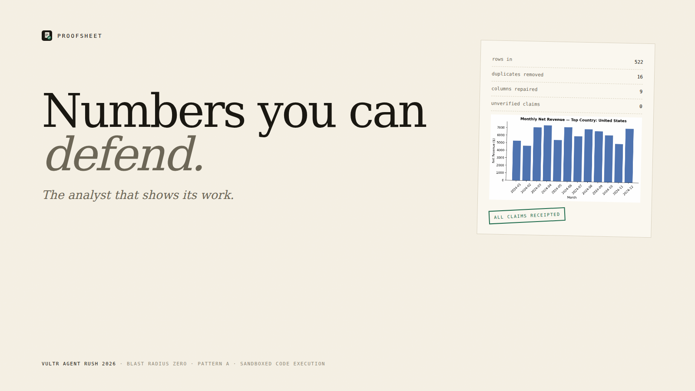
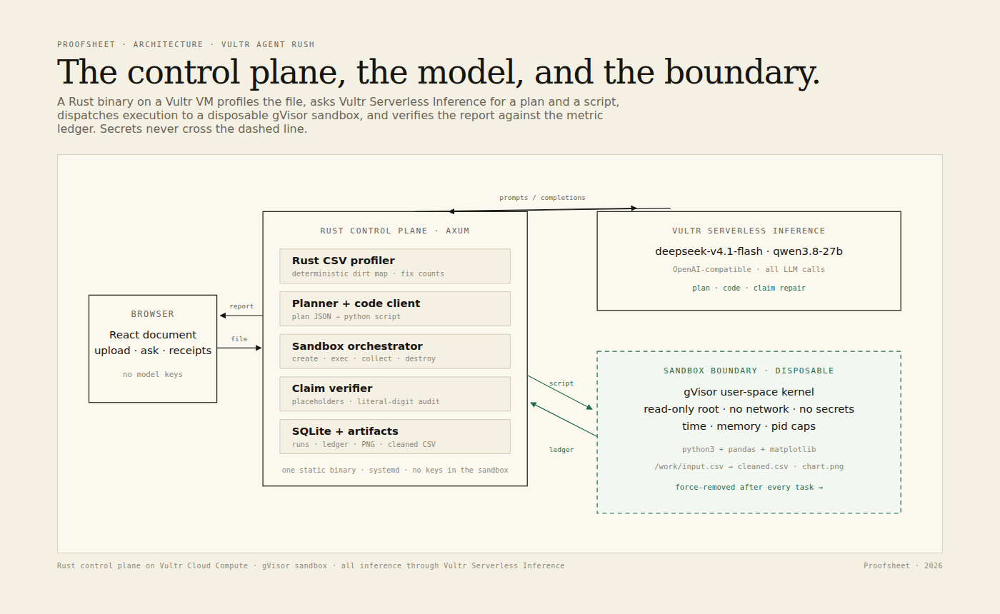
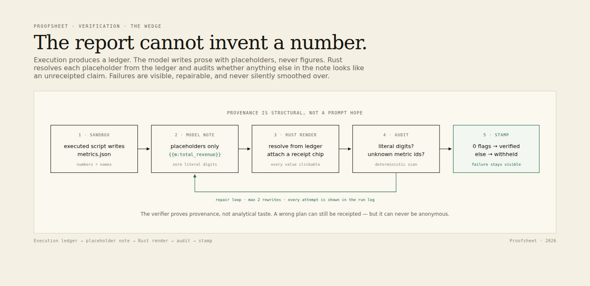

# Proofsheet — the analyst that shows its work

**Vultr: Agent Rush Hackathon · Blast Radius Zero · Pattern A (sandboxed code execution)**

> Drop a messy CSV. Proofsheet writes the analysis code, runs it in a disposable
> **gVisor** sandbox on a Vultr VM, and returns a cleaned file, an executed chart,
> and a report where **every number and every name is receipted** to the execution
> that produced it.



| | |
|---|---|
| **Live demo** | **http://149.28.225.246** |
| **Demo video (earlier build, 98s)** | [docs/demo.mp4](docs/demo.mp4) |
| **Example report** | http://149.28.225.246/r/1ce45831-f316-4728-82c0-e7755f363db7 |
| **Deterministic replay** | http://149.28.225.246/r/000fd16c-35f3-4f3a-a6e5-6eb7a92954d1 |
| **Containment drill** | http://149.28.225.246/drill |
| **Architecture page** | http://149.28.225.246/how |
| **Source** | https://github.com/PhiBao/proofsheet |

---

## The problem

Every AI data tool can produce a chart. The hard part is defending the number in a
board deck when someone asks where it came from. Analysts spend most of their time
cleaning the export (`r/dataanalysis`: "80% of effort involves prepping and cleaning
data"), then re-checking the output. The failure mode is vivid: a model can invent a
plausible figure inside a chart and no one notices until it is expensive — Andrej
Karpathy's widely shared ChatGPT chart incident is the canonical example.

The missing layer is not a better prompt. It is **provenance**: a control plane that
separates planning, execution, and claim rendering, and refuses to let the last one
invent anything.

## What Proofsheet does

1. **Profiles the file in Rust, before any model sees it.** Duplicate rows, mixed date
   formats, currency text, percent strings, nulls, ambiguous labels. The dirt map is
   deterministic and reproducible.
2. **Plans, then executes.** A Vultr-hosted model writes a pandas script. A separate
   Rust control plane runs it in a fresh gVisor container with no network, no secrets,
   a read-only root, and hard time/memory/pid caps.
3. **Receipts every claim.** The sandbox writes a metric ledger. The analyst note may
   only cite values as `{{m:metric_id}}` placeholders. Rust renders them from the
   ledger and audits the result for literal digits or unknown ids. If the audit fails,
   the model rewrites the note; if it still fails, the report keeps the flag and
   withholds the verified stamp.
4. **Replays deterministically.** A saved pipeline can be re-executed on a new export
   with **no model in the loop**; the same definition, script and template are reused,
   and the new metrics are compared with the previous export.

The model is allowed to plan and write code. It is not allowed to author a figure.

### The trust layer

- **Definition lock.** Before execution, the planner proposes the business rules and
  the user approves them: shipping in or out, status scope, missing values, discount
  semantics, date-format precedence. The approved definition is stored with the run,
  included in every receipt, and reused on replay.
- **Chart audit.** The chart emits its plotted series. Rust checks that a summed series
  matches the ledger, the top category matches a receipted name, the peak month matches,
  every approved assumption is recorded, and `rows_used` is plausible.
- **Independent execution.** A second model, which never sees the analyst script,
  recomputes the same metrics from the approved definition in a separate gVisor sandbox.
  Both executions import the same deterministic `contract.py` for parsing, so the check
  is about aggregation and logic, not parser luck. Agreement produces the two-execution
  stamp; disagreement withholds it.
- **Assurance bundle.** One JSON download contains the dataset hash, definition, plan,
  code, ledger, chart data, consensus, isolation level and a combined integrity hash.
- **Period comparison.** A replay computes the delta against the source run in Rust and
  shows previous → current → change, with no model in the loop.

## The verification model (the wedge)

A normal AI data tool produces: `question → model → prose + chart`. There is no
mechanical relationship between the prose and the computation.

Proofsheet produces:

```
question → plan → python script → sandbox execution
                                      ├── cleaned.csv
                                      ├── chart.png        (real artifact)
                                      └── metrics.json     (the ledger)
                                                 │
note template with {{m:id}} placeholders ────────┘
        │
        ├── Rust renders every placeholder from the ledger
        ├── verifier scans for literal digits / unknown ids
        ├── fail → model rewrites (max 2), visibly
        └── pass → report is stamped "all claims receipted"
```

Important honesty note: the verifier guarantees **provenance**, not analytical taste.
A wrong plan can still produce a receipted wrong answer; the executed code is shown in
the UI so a human can catch it. The product makes the number traceable, not infallible.

## Containment: Blast Radius Zero

The containment page runs hostile code **live** — not a recording. Each step gets a
fresh sandbox and is force-removed afterwards. The host keeps a canary file whose hash
is checked before and after every step.

| Step | Command | Expected verdict |
|---|---|---|
| Destructive filesystem | `rm -rf --no-preserve-root /` | **absorbed** — read-only root, only `/work` mounted |
| Process exhaustion | fork until the kernel refuses | **contained** — pids limit 192 (`BLOCKED after 191 forks`) |
| Runaway CPU loop | `while True: pass` | **contained** — killed at the 5s wall-clock cap |
| Credential exfiltration | dump env + common secret paths | **blocked** — no Vultr or inference key in the sandbox |
| Outbound network | connect to `1.1.1.1:80` | **blocked** — `--network none` |
| Host filesystem probe | read `/opt/proofsheet/canary/canary.txt` | **blocked** — path does not exist inside the sandbox |

The drill page shows the exact commands, exit codes, durations, sandbox ids, output
excerpts and a host proof panel (canary intact, host uptime, control-plane PID, teardown).
Verified on production: **6/6, canary intact**, with `gVisor user-space kernel`.

## Architecture



**Runtime:** a single Rust binary (Axum + Tokio + SQLx) on a Vultr Cloud Compute VM
(`ewr`, Ubuntu 24.04, 4 vCPU / 8 GB). It serves the React document, profiles CSVs, calls
Vultr Serverless Inference, orchestrates sandboxes, verifies claims, and serves artifacts.

**Inference:** all LLM calls go through Vultr Serverless Inference
(`https://api.vultrinference.com/v1`, OpenAI-compatible):

- `deepseek-v4.1-flash-1017` — planner and note repair
- `qwen3.8-27b` — code generation
- `chat_template_kwargs.enable_thinking=false` cuts task-shaped generation from ~60s to ~6s

**Sandbox:** Docker + gVisor (`runsc`) — a user-space kernel, not a shared-kernel
container. The sandbox image (`python:3.12-slim` + pandas/matplotlib) is prebuilt on the
VM. Each task:

```
create → mount per-run workdir → exec python3 /work/script.py → collect artifacts
      → force-remove container (no reuse, no state carry-over)
```

Flags: `--network none`, `--read-only`, `--cap-drop ALL`, `--security-opt
no-new-privileges`, `--user 65534`, `--memory 1g`, `--cpus 1.5`, `--pids-limit 192`,
per-task wall-clock timeout. The Vultr key and inference key never enter the sandbox.

**Verification:**



**Data:** SQLite for datasets/runs/drills; artifacts on local disk
(`cleaned.csv`, `chart.png`, `metrics.json`, `notes.md`, `script.py`). The UI streams
run state by polling, so the demo survives SSE/proxy issues.

### Key technical decisions

| Decision | Why |
|---|---|
| Rust control plane | Strong typing for the ledger/claim model; one static binary; no runtime to babysit on the VM. |
| Deterministic dirty-profiling in Rust | The "what is dirty" verdict must not be model-generated. It also produces the fix counts in "What changed". |
| Metric ledger + placeholders | Makes "the prose cannot invent a number" a structural property, not a prompt hope. |
| Text metrics | Categorical facts (top country, peak month) are receipted too, not just numbers. |
| gVisor over plain Docker | Stronger isolation story that is still one `docker run` away; the UI reports the actual boundary per run. |
| Deterministic replay | Proves the saved pipeline is an asset, not a chat transcript; retention loop with no model in the loop. |
| Vanilla CSS design system | Avoids generic component-library UI; the document/receipt aesthetic is the product. |

## What is real vs. mocked

| Claim | Status |
|---|---|
| CSV profiling, duplicate counts, dirty-value counts | **Real** — Rust, computed on every upload |
| Vultr Serverless Inference calls | **Real** — planner, code, note repair |
| pandas execution | **Real** — inside gVisor, artifacts collected from the sandbox |
| Chart | **Real** — PNG generated by the executed script |
| Metric ledger | **Real** — `metrics.json` written by the executed script |
| Claim receipts | **Real** — placeholders resolved in Rust; literal-digit audit |
| Definition lock | **Real** — approved assumptions stored with the run and reused on replay |
| Chart data audit | **Real** — series, top category, peak month, assumptions and `rows_used` checked in Rust |
| Independent execution | **Real** — second model, separate sandbox, shared deterministic parsing contract |
| Assurance bundle | **Real** — hashes over dataset, definition, code, ledger and chart data |
| Period comparison | **Real** — Rust-computed from two ledgers |
| Containment steps | **Real** — executed live on the production VM |
| Host canary | **Real** — checked before/after every step |
| Deterministic replay | **Real** — saved script re-executed, no model call |
| Prompt privacy | **Real** — model prompts receive column shapes and redacted examples; free-text samples are omitted |
| Share links | **Real but unlisted** — anyone with the URL can read a report; there is no auth |
| Multi-tenancy / billing / scheduled replays | **Not built** — see limitations |

Nothing in the core data path is mocked. There is no hard-coded answer, no fake chart,
and no simulated sandbox verdict.

## Hackathon relevance

- **Track:** one main challenge, *Blast Radius Zero*; Pattern A, sandboxed code execution.
- **Required stack:** backend on a Vultr VM; **all** agent LLM calls through Vultr
  Serverless Inference; sandbox boundary as containers on Vultr, never in the app
  process. All satisfied.
- **Deliverables:** public repo, deployed backend, public demo URL, recorded video with
  a containment moment, architecture explanation.
- **Judging:** *Application of Technology* (real execution + gVisor + Vultr inference),
  *Business Value* (analyst hours + trust), *Originality* (claim-level receipts and a
  verification layer, not another chart tool), *Presentation* (the report itself is the
  demo).

## Running locally

### Prerequisites

- Rust (stable, 1.85+)
- Node 22 + pnpm
- Docker (gVisor optional)
- A Vultr Serverless Inference subscription and API key

### Build

```bash
# 1. Frontend first — the Rust binary embeds web/dist at compile time.
cd web
pnpm install
pnpm build
cd ..

# 2. Sandbox image
docker build -t proofsheet-sandbox:latest -f Dockerfile.sandbox .

# 3. Backend
cp .env.example .env          # set VULTR_INFERENCE_API_KEY
cargo run --release
```

Open `http://localhost:8080`. To develop the frontend with hot reload:

```bash
cd web && pnpm dev            # proxies /api to 127.0.0.1:8080
```

### Environment

| Variable | Default | Notes |
|---|---|---|
| `VULTR_INFERENCE_API_KEY` | required | Serverless Inference subscription key |
| `VULTR_INFERENCE_BASE_URL` | `https://api.vultrinference.com/v1` | OpenAI-compatible |
| `PROOFSHEET_BIND` | `0.0.0.0:8080` | production uses `:80` |
| `PROOFSHEET_DATA_DIR` | `data` | uploads, artifacts, work dirs, SQLite |
| `PROOFSHEET_SANDBOX` | `auto` | `auto` prefers gVisor, falls back to Docker; `runsc`, `docker` force |
| `PROOFSHEET_SANDBOX_IMAGE` | `proofsheet-sandbox:latest` | prebuilt image |
| `PROOFSHEET_SANDBOX_TIMEOUT` | `90` | seconds per task |
| `PROOFSHEET_MODEL_PLAN` | `deepseek-v4.1-flash-1017` | |
| `PROOFSHEET_MODEL_CODE` | `qwen3.8-27b` | |
| `PROOFSHEET_MODEL_REPAIR` | `deepseek-v4.1-flash-1017` | |
| `PROOFSHEET_CANARY_PATH` | `<data>/canary.txt` | production: `/opt/proofsheet/canary/canary.txt` |
| `PROOFSHEET_REGION` | `local` | shown in the UI |

### Tests

```bash
cargo test                 # 7 tests, including the 15-case golden suite
```

The `/api/health` and `/api/proof` endpoints also run live checks on each request:
verifier self-test (6/6), golden product checks (15/15) and dirty-fixture checks (3/3).
No hard-coded pass counts; the checks re-profile the bundled fixtures and exercise the
verifier and chart auditor.

### API smoke test

```bash
BASE=http://localhost:8080 ./scripts/smoke.sh
```

It creates a sample dataset, asks a question, polls the run, and prints the report URL.
The script does not assume the answer; it checks that the run completes and that the
verifier reports zero unverified claims.

## Deployment (the production setup used for the demo)

```bash
# On a fresh Ubuntu 24.04 Vultr VM:
apt-get install -y docker.io build-essential pkg-config libssl-dev
# install gVisor: download the gvisor-x86_64 tarball, install runsc, register it in
# /etc/docker/daemon.json, copy gvisor-bin next to the runsc binary.
# install Rust, sync this repo to /opt/proofsheet, build the frontend and backend.

docker build -t proofsheet-sandbox:latest -f Dockerfile.sandbox .
# .env as above, then:
systemctl enable --now proofsheet
```

`proofsheet.service` runs the release binary as root (needed for the Docker socket),
with `.env` mode `600`. The firewall allows 22/80/443; the app binds `0.0.0.0:80`.

## Security model

- **Secrets:** only in the Rust process environment. Never serialized into prompts,
  scripts, the sandbox environment, or artifacts.
- **Sandbox:** gVisor user-space kernel; read-only root; per-run workdir; no network;
  all capabilities dropped; no-new-privileges; non-root user; memory/CPU/pid/time caps.
- **Uploads:** 12 MB cap, CSV parsing with a bounded reader, deterministic failures.
- **Artifacts:** served only by allowlisted filename and a UUID-validated run id.
- **Share links:** reports are unlisted UUID URLs. This is not authentication; do not
  upload sensitive data to the public demo.
- **Known key exposure:** the Vultr and inference keys used during the build were shared
  in plaintext during the session; they are not committed (`.env` is gitignored) and
  should be rotated after judging.
- **Not built:** user accounts, per-user isolation, rate limiting, audit logs, billing.

## Limitations

- Best on tabular CSV up to 12 MB. Very exotic schemas may need one visible repair attempt.
- Code generation is probabilistic; the verifier proves provenance, not the quality of
  the plan. The executed code is always exposed for review.
- The demo is single-tenant and unlisted, not private.
- Isolation is gVisor on one VM; production would use one microVM per task
  (Microsandbox/Firecracker) and object storage for artifacts.
- The chart is an execution artifact; the claim audit covers the prose and ledger, not
  pixels in the PNG.

## Business model (hypothesis, not a claim)

- **Buyer:** ops/finance/founder-analyst at a 5–200 person company with a recurring export.
- **Value anchor:** hours of cleaning plus the cost of a wrong number in a decision document.
- **Pricing hypothesis:** $29–99 per analyst seat/month, or $199–499 per team.
- **Retention:** saved pipelines replay on next month's export with no model in the loop;
  switching cost accumulates with every saved pipeline.
- **Distribution:** the verified report is shareable; every share carries the receipt
  model into a room where someone else has the same Monday export.
- **Expansion:** the same control plane for every recurring data task — support tickets,
  ad spend, inventory, finance close.

## Repository layout

```
src/
  main.rs            Axum server, static assets, startup
  api.rs             HTTP API, multipart upload, artifacts, drills
  agent.rs           plan → code → execute → repair → verify loop
  profile.rs         deterministic CSV profiling, residual-dirt audit, clean diff
  verify.rs          placeholder renderer, literal-digit audit, self-test
  inference.rs       Vultr Serverless Inference client
  sandbox/           sandbox trait + Docker/gVisor backend
  drill.rs           live containment drill suite
  store.rs, models.rs, config.rs
web/                 React + TypeScript document UI, custom design system
fixtures/            deterministic dirty CSVs + generator
docs/                architecture and verification diagrams
scripts/smoke.sh     end-to-end API smoke test
Dockerfile.sandbox   python + pandas + matplotlib execution image
```

## Demo script (3 minutes)

1. **0:00** Landing: "Numbers you can defend." Open the sample dirty export.
2. **0:15** The profile exposes duplicates, five date formats, currency text, percent
   strings and casing chaos before any model runs.
3. **0:30** Ask: *"Clean this export. What was monthly net revenue, and which country
   generated the most?"* The plan appears. Approve the **definition**: shipping out,
   completed + shipped only, missing values excluded, discounts read as fractions,
   date-format precedence explicit.
4. **0:50** Run. Watch the plan, code, primary sandbox, claim audit, chart audit, and the
   second independent sandbox.
5. **1:25** The report: 522 → 506 rows, 16 duplicates, 9 columns repaired, a real chart,
   **two executions agree**, every claim receipted. Click a receipt: code, stdout,
   isolation and sandbox id. Download the assurance bundle.
6. **1:55** **Try to make it lie** injects a fake claim; the verifier flags it and the
   stamp is withheld.
7. **2:15** Containment: run the drill live. `rm -rf` is absorbed; the fork bomb hits the
   pids limit; the network and host probes are blocked; the host canary is intact.
8. **2:40** Replay on a new export: +3.0% revenue, rows unchanged, no model in the loop.
   Close on the verified stamp.
